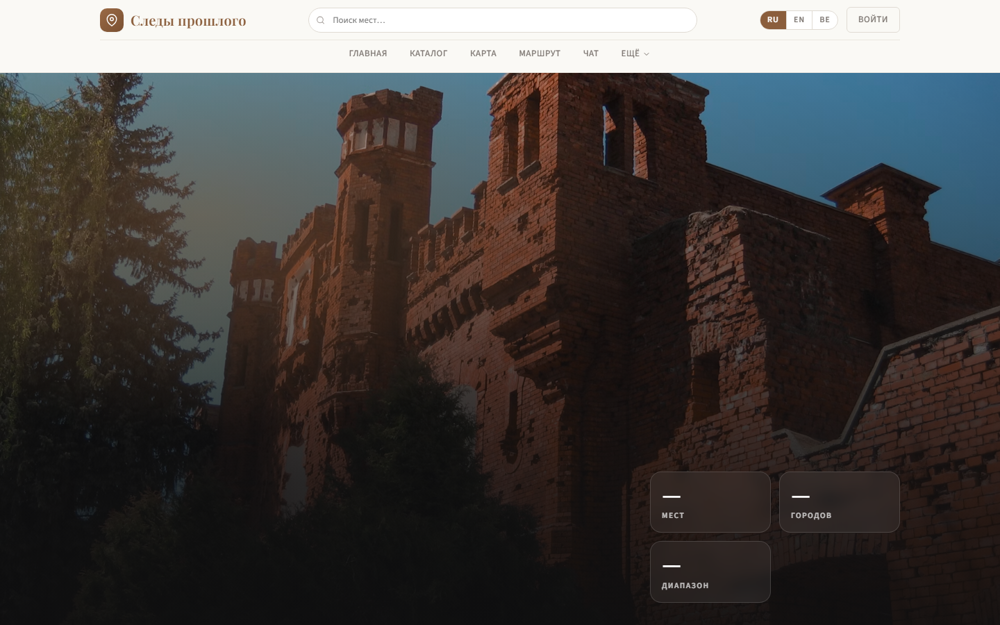
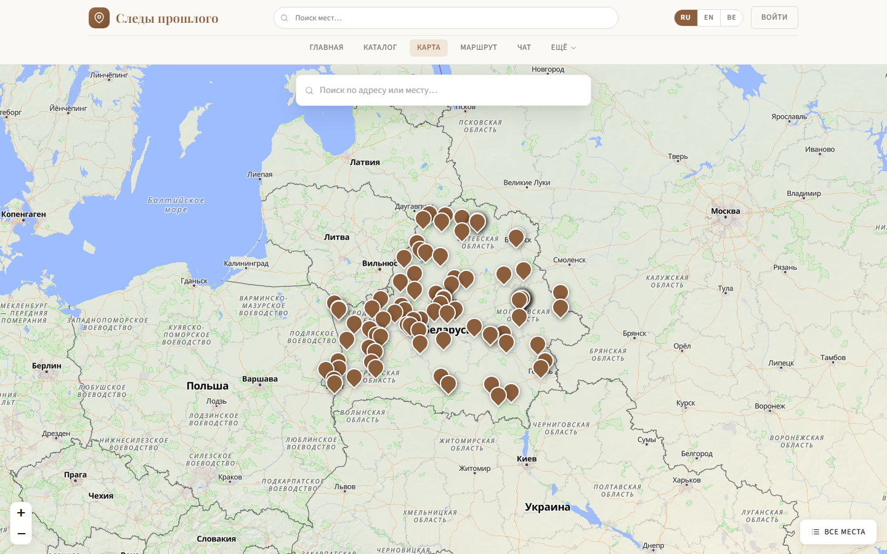

# Следы прошлого (Traces) — веб-версия

Путеводитель по памятным местам Беларуси и региона: каталог исторических объектов, интерактивная карта, планировщик маршрутов и ИИ-гид.

**Сайт:** https://traces-ffd5c.web.app/



## О проекте

Traces — дипломный проект, состоящий из веб-сайта и [мобильного приложения для Android](https://github.com/TheFulum/traces.mobile-app). Обе версии работают с общей базой данных и общими учётными записями.

Цель проекта — собрать в одном месте сведения о памятных местах (крепости, храмы, усадьбы, мемориалы) и помочь спланировать поездку: найти объекты на карте, составить маршрут по дорогам и получить рекомендации от ИИ-гида.



## Возможности

- **Каталог мест** с поиском по названию, адресу и тегам, фильтрами по городу, годам, наличию фото и 3D-модели. Фильтры сохраняются в URL, поэтому подборкой можно поделиться ссылкой.
- **Карточка места**: описание, фотогалерея, 3D-модели (Sketchfab), отзывы и оценки посетителей.
- **Интерактивная карта** на OpenStreetMap с поиском по адресу.
- **Планировщик маршрута**: построение пути по дорогам, оптимизация порядка точек, распределение по дням, сохранение нескольких маршрутов.
- **ИИ-гид в чате** отвечает на вопросы о местах и предлагает маршрут по городу или области из объектов каталога.
- **Личный кабинет**: сохранённые маршруты, избранное, отзывы, уведомления.
- **Панель администратора**: статистика, управление контентными страницами, модерация пользователей, публикация APK-файлов приложения.
- **Три языка интерфейса**: русский, белорусский и английский.

## Технологии

- HTML, CSS, JavaScript (ES-модули), без фреймворков
- Firebase: Authentication, Cloud Firestore, Hosting
- Leaflet и OpenStreetMap, построение маршрутов через OSRM
- Cloudflare Workers, R2 и KV: серверная логика ИИ-гида и хранение медиафайлов
- OpenRouter (LLM) для ИИ-гида
- Sketchfab для встраивания 3D-моделей

## Структура

```
index.html, login.html   главная и вход
pages/                   каталог, карта, маршрут, чат, карточка места, профиль, обратная связь
admin/                   панель администратора
js/                      логика страниц, общие модули, локализация (ru, be, en)
css/                     стили
firestore.rules          правила доступа к базе данных
```

## Запуск

Сайт статичный: достаточно открыть его через любой локальный HTTP-сервер (например, `npx serve .`). Для работы с данными нужен свой проект Firebase: параметры подключения задаются в `js/shared/firebase-init.js`, правила доступа — в `firestore.rules`.

---

Автор — [Липовский Даниил](https://github.com/TheFulum)
